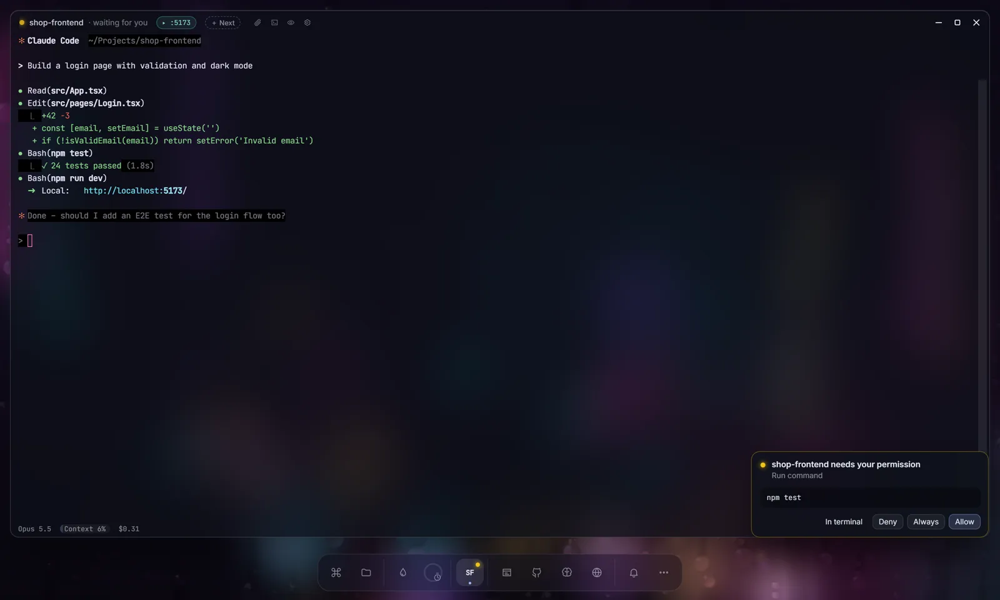
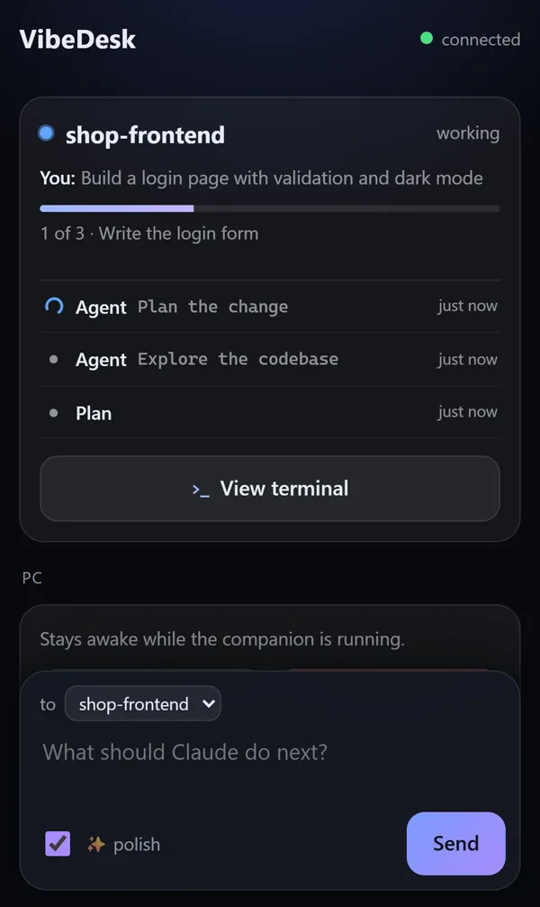
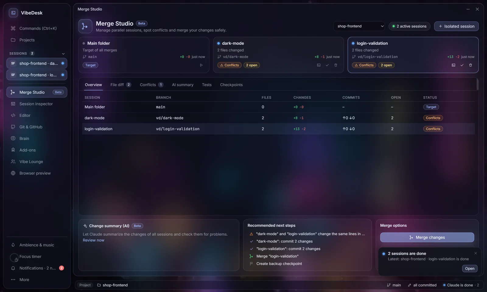
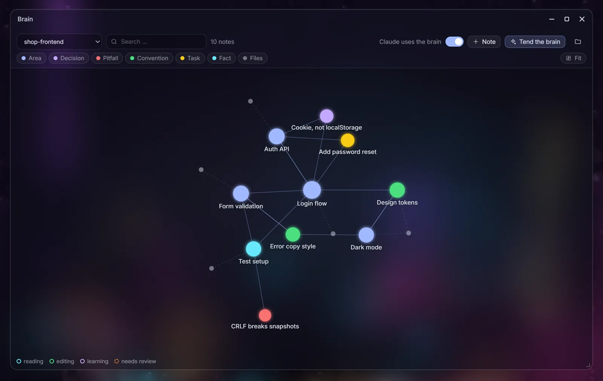
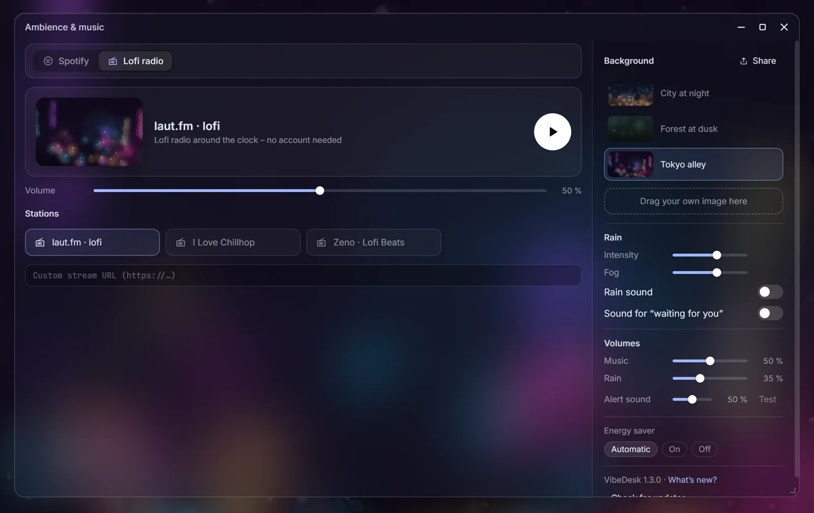
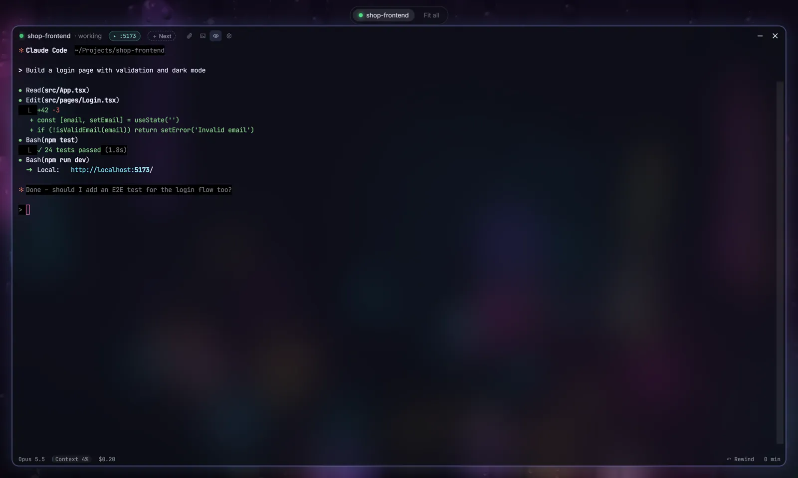
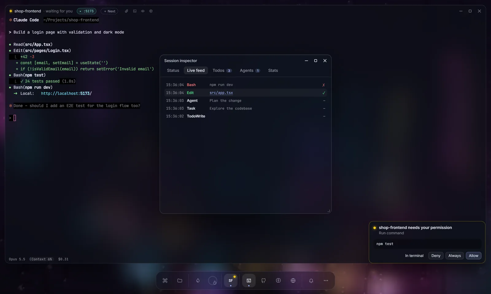

<div align="center">

<a href="https://fxd-gif.github.io/vibedesk/"></a>

<br/>

<a href="https://github.com/fxd-gif/vibedesk/releases/latest"></a>&nbsp;&nbsp;<a href="https://www.youtube.com/watch?v=SLLYiK34I88"></a>

<br/>

[](https://github.com/fxd-gif/vibedesk/releases/latest)
[](LICENSE)

[](https://m8ven.ai/mcp/fxd-gif-vibedesk-nx57jc?s=readme)

[English](README.md) · **Deutsch** · [Website](https://fxd-gif.github.io/vibedesk/)

</div>

<br/>

VibeDesk ist eine Vollbild-Arbeitsumgebung für Windows, gebaut für das Arbeiten mit [Claude Code](https://docs.claude.com/en/docs/claude-code). Statt zwischen Terminals, Browser und Musik-App hin- und herzuspringen, sitzt du vor einer verregneten Fensterscheibe – und alles, was du zum Bauen brauchst, schwebt in Glasfenstern davor.

In den Terminals läuft das echte Claude Code. VibeDesk legt den Blick darum: was jede Session gerade tut, worauf sie wartet und was sie kostet.

<p align="center"></p>

<br/>

<table>
<tr>
<td width="56%"></td>
<td>

### Alle Sessions auf einen Blick

Ein Punkt pro Session: **grün**, solange Claude arbeitet, **gelb**, wenn es auf dich wartet (und wie lange schon), **blau**, wenn es fertig ist.

Freigaben kommen als Karte mit *Erlauben*, *Immer* und *Ablehnen*. Du suchst nie wieder in vier Terminals nach dem einen, das hängt.

</td>
</tr>
<tr>
<td>

### Aufstehen, ohne Zeit zu verlieren

Öffne VibeDesk auf dem Handy, scanne einen QR-Code und beantworte Freigaben vom Sofa aus. Schau dem Terminal live zu, schubs Claude mit ein paar Tasten an oder tipp eine grobe Idee, aus der Claude einen klaren Prompt macht.

Nutzungslimit erreicht? VibeDesk wartet den Reset ab und lässt Claude dann weitermachen.

</td>
<td width="44%" align="center"></td>
</tr>
<tr>
<td width="56%"></td>
<td>

### Parallel arbeiten, sicher zusammenführen

Merge Studio gibt jeder Session einen eigenen Git-Worktree und Branch. Es erkennt Konflikte, bevor etwas angefasst wird, zeigt die Dateien nebeneinander und setzt vor jedem Merge einen Checkpoint.

Übernimm einen ganzen Branch, einzelne Dateien oder einzelne Abschnitte. Zurück geht es mit einem Klick.

</td>
</tr>
<tr>
<td>

### Claude merkt sich dein Projekt

Das Gehirn sind Markdown-Notizen in deinem Projekt, lesbar in Obsidian. Claude liest es zu Beginn jeder Session und schreibt Entscheidungen, Stolperfallen und Regeln mit.

Ein persönliches Gehirn merkt sich, wie *du* arbeitest, über alle Projekte hinweg. Nichts davon verlässt deinen PC.

</td>
<td width="44%"></td>
</tr>
<tr>
<td width="56%"></td>
<td>

### Ein ruhiger Ort

Regen läuft die Scheibe herunter, vor einer Stadt bei Nacht, einem Wald, einer Gasse in Tokio oder deinem eigenen Foto. Lofi-Radio oder dein Spotify, ein Fokus-Timer und Regengeräusch mit eigener Lautstärke.

Das Dock wächst mit deiner Arbeit. Werkzeuge tauchen erst auf, wenn sie etwas zu tun haben.

</td>
</tr>
<tr>
<td>

### Zen, wenn du ihn brauchst

<kbd>Strg</kbd> + <kbd>.</kbd> blendet alles aus außer Claude und dem Regen. Andere Sessions schrumpfen zu kleinen Pillen oben und werden trotzdem gelb, wenn sie dich brauchen.

Eine Karte auf einmal, „fertig“-Meldungen werden gebündelt, und das Dock blendet sich beim Tippen ab.

</td>
<td width="44%"></td>
</tr>
</table>

<br/>

## Kommt mit 2.0 &nbsp;<sub>Sonntag, 1. November 2026</sub>

Wir bringen lieber ein größeres, getestetes Release als viele kleine. Countdown und Plan stehen auf der [Website](https://fxd-gif.github.io/vibedesk/#next).

<table>
<tr>
<td width="50%" valign="top">

**🌨️ Lebende Szenen**<br/>
Wünsch dir von Claude einen interaktiven Hintergrund: Schnee, der auf dem Dach in deinem eigenen Foto liegen bleibt, Glühwürmchen, die deiner Maus folgen, ein Gewitter auf Klick. Claude schreibt die Szene, schaut sie sich an und bessert nach.

</td>
<td width="50%" valign="top">

**✅ Session-Abschluss** · [#1](https://github.com/fxd-gif/vibedesk/issues/1)<br/>
Ist Claude fertig, bekommst du eine kurze Zusammenfassung, die geänderten Dateien, was ins Gehirn kam, und einen Commit-Vorschlag. Ein Klick committet alles.

</td>
</tr>
<tr>
<td valign="top">

**🔀 Pull Requests aus dem Git-Fenster** · [#2](https://github.com/fxd-gif/vibedesk/issues/2)<br/>
Branch, Push und PR, ohne VibeDesk zu verlassen. Claude schreibt Titel und Beschreibung, du prüfst und schickst ab.

</td>
<td valign="top">

**🟡 Tray-Status** · [#3](https://github.com/fxd-gif/vibedesk/issues/3)<br/>
Sieh auch bei minimiertem VibeDesk, welche Session auf dich wartet, und beantworte Freigaben direkt im Infobereich.

</td>
</tr>
<tr>
<td valign="top">

**📊 Budget pro Projekt** · [#4](https://github.com/fxd-gif/vibedesk/issues/4)<br/>
Leg ein Kosten- oder Token-Budget pro Tag oder Woche fest. Bei 75 % ein leiser Hinweis, bei 100 % eine Mitteilung. Claude wird nie angehalten.

</td>
<td valign="top">

**🧭 Claude bedient deinen Desktop**<br/>
Claude sieht deine anderen Sessions und schickt ihnen Aufträge, fragt Verbrauch und Limits ab, setzt ein Budget und erinnert dich an etwas.

</td>
</tr>
</table>

<details>
<summary><b>Außerdem in 2.0</b></summary>

- **Übergabe zwischen Sessions** · [#6](https://github.com/fxd-gif/vibedesk/issues/6): Gibt eine Session einer anderen einen Auftrag, gehen Zusammenfassung und geänderte Dateien mit
- **Wie lange wartet Claude schon?** · [#5](https://github.com/fxd-gif/vibedesk/issues/5): „wartet · 3 min“ an der Session, im Tray und auf dem Handy
- **Projekt-Vorlagen:** Neues Projekt als Website, React-App, kleines Spiel, Python-Werkzeug, Discord-Bot und mehr – Claude legt das Gerüst an
- **Eigene Musik:** Musik aus einem Ordner auf deinem PC, neben Lofi-Radio und Spotify
- **Hotspots im Gehirn:** Oft geänderte Dateien leuchten warm, die ohne Notiz bekommen einen gepunkteten Ring
- **Fenster pro Projekt:** Werkzeug-Fenster kommen in jedem Projekt an ihren Platz zurück
- **Git-Fenster:** „Claude löst das“ bei Konflikten und ein leiser Gehirn-Check vor dem Commit
- **Diktieren und Ausschneiden:** Sprich mit Claude über die Windows-Spracheingabe oder schick einen Bildschirmausschnitt als Bild
- **Gehirn aus deinen Dokumenten:** `CLAUDE.md`, `AGENTS.md` und README werden sofort und ohne Tokens zu verlinkten Startnotizen
- **Addons:** neue Auslöser (Datei geändert, Werkzeug benutzt, Commit, Fehler in der Vorschau) und ein Flow-Debugger, der den laufenden Schritt zeigt
- **Diagnose, Leistungsanzeige und eine Szene, die der Tageszeit folgt**

</details>

Fehlt dir etwas? [Wünsch dir ein Feature](https://github.com/fxd-gif/vibedesk/issues/new?template=feature_request.yml). Die Wünsche mit den meisten 👍 kommen ins nächste Release.

<br/>

## Alles, was VibeDesk kann

<details>
<summary><b>Ruhig von Anfang an</b></summary>

- Das Dock wächst mit deiner Arbeit: Werkzeuge erscheinen erst, wenn sie etwas zu tun haben (Git, sobald Claude Dateien geändert hat, Merge Studio bei zwei Sessions, …)
- **Werkzeugkasten:** „Einfach“ starten und Module wie Addons, Handy-Begleiter, Discord oder Streamer-Modus dazuschalten, wenn du sie willst
- **Zen-Modus** (<kbd>Strg</kbd> + <kbd>.</kbd>): nur Claude und der Regen, andere Sessions als kleine Pillen oben
- Eine Karte auf einmal, „fertig“-Meldungen werden gebündelt, und das Dock blendet sich beim Tippen ab
- **Zwei Aufbau-Varianten.** *Desktop:* frei schwebende Glasfenster und ein Dock, das mit dem wächst, was du nutzt *Studio:* Seitenleiste links, jedes Fenster als ganze Seite und eine Statusleiste mit Projekt, Branch, offenen Änderungen und dem, was Claude gerade tut. Umschalten in den Einstellungen oder per Befehlspalette

</details>

<details>
<summary><b>Atmosphäre</b></summary>

- Regen auf der Scheibe (WebGL) – Stadt bei Nacht, Wald, Tokio-Gasse oder dein eigenes Bild
- Lofi-Radio oder **Spotify** (steuert deine Spotify-App: Playlists, Lieblingssongs, Warteschlange), dazu synthetisches Regengeräusch, getrennt regelbar
- **Eigene Musik** aus einem Ordner auf deinem PC (mp3, m4a, aac, ogg, opus, wav, flac): Unterordner als Gruppen, Zufall, Wiederholen, merkt sich den letzten Titel – ohne Konto, ohne Internet, nichts verlässt deinen PC
- Fokus-Timer (Pomodoro) – in Pausen wird es automatisch leiser
- Streamer-Modus: schwärzt API-Keys, Passwörter, Benutzernamen und E-Mails, sperrt `.env` & Co. im Editor; der Vorhang (<kbd>Strg</kbd> + <kbd>⇧</kbd> + <kbd>H</kbd>) verdeckt sofort den ganzen Bildschirm

</details>

<details>
<summary><b>Claude-Code-Sessions</b></summary>

- Mehrere Sessions parallel, mit Status im Dock: arbeitet · wartet auf dich · fertig
- Freigabe-Karten mit Erlauben · Immer · Ablehnen – oder „Im Terminal“ für die gewohnte Frage
- Mitteilungen als Karten, Windows-Benachrichtigungen im Hintergrund, Verlauf hinter der Glocke – in Fokus-Runden kommt nur Wichtiges durch
- Prompt-Warteschlange: Aufträge vormerken, die losgehen, sobald Claude fertig ist
- Schnell-Prompt von überall: <kbd>Strg</kbd> + <kbd>Alt</kbd> + <kbd>Leertaste</kbd> öffnet über jeder App ein Eingabefeld
- Wächter: meldet sich, wenn eine Session lange hängt, dreimal am selben Befehl scheitert oder der Kontext zu 85 % voll ist – mit passendem nächsten Schritt
- Terminal mit Kopieren/Einfügen wie im Windows Terminal, klickbaren Links und Dateipfaden, Suche, Zoom, Anhängen und einer PowerShell neben Claude
- Frühere Sessions mit einem Klick fortsetzen
- Nutzungslimit erreicht? VibeDesk liest die Reset-Zeit und lässt Claude danach von selbst weitermachen
- Zurückspulen: Gespräch und Code auf einen früheren Schritt zurücksetzen
- **Plan-Karte:** Pläne aus dem Plan-Modus als lesbare Karte – „Los geht’s“ oder „Ändern …“ mit Rückmeldung an Claude
- **Abo-Limit im Blick** (Pro/Max): wie viel vom 5-Stunden- und Wochenlimit verbraucht ist, leiser Hinweis bei 75 % und 90 %
- **Dev-Server per Klick:** „▶ Dev-Server“ startet dein `dev`-Skript (npm, pnpm, yarn oder bun) in einer Shell neben Claude
- **Claude bedient VibeDesk (MCP):** „Sortier meine Fenster“, „Zen-Modus an“, „Tokyo-Szene mit mehr Regen“ – Claude erledigt es

</details>

<details>
<summary><b>Merge Studio (Beta): parallele Sessions</b></summary>

- „Isolierte Session“: Claude bekommt einen eigenen Arbeitsordner (Git-Worktree) auf eigenem Branch – parallele Sessions kommen sich nie in die Quere
- Session-Karten mit Branch, geänderten Dateien, +/−, Live-Status und Badge: bereit · prüfen · Konflikte
- Konflikt-Vorhersage per `git merge-tree` – gegen den Ziel-Branch und zwischen Sessions, auch für noch nicht committete Änderungen –, ohne etwas zu verändern
- Datei-Vergleich nebeneinander: Session · aktuelles Ziel · andere Session
- Ganzen Branch, ausgewählte Dateien oder ausgewählte Abschnitte übernehmen (3-Wege-Apply). Ungespeicherte Änderungen im Ziel werden nie überschrieben, alles Riskante fragt vorher nach
- Automatische Checkpoints vor jedem Merge (als Git-Refs unter `refs/vibedesk/checkpoints`, nicht in deiner Historie) und Wiederherstellen per Klick
- KI-Zusammenfassung mit Risiken und empfohlenen nächsten Schritten; Tests vor dem Merge direkt im Ordner der Session

</details>

<details>
<summary><b>Inspector und Stats</b></summary>



- Live-Feed aller Aktionen, Todo-Fortschritt, Agent-Baum für Subagents und Stats in einem Fenster mit Tabs
- Context-Auslastung, Tokens, Cache-Trefferquote und geschätzte Kosten – pro Session und pro Tag
- Vibe Wrapped: dein Wochenrückblick (aktive Zeit, Prompts, geänderte Dateien, Top-Projekte) als Bild zum Teilen

</details>

<details>
<summary><b>Das Gehirn (Projektgedächtnis)</b></summary>

- Notizen in `.vibedesk/brain` im Projekt: Markdown mit `[[Links]]`, direkt in Obsidian zu öffnen und mit Git zu versionieren
- Jede Session startet mit einem Überblick über dieses Wissen und kann es über eigene Werkzeuge durchsuchen, lesen und erweitern
- **Über dich:** ein persönliches Gehirn, das in allen Projekten gilt. Claude merkt sich, wie du arbeitest und was du magst – je länger du VibeDesk nutzt, desto besser passt Claude zu dir. Liegt nur auf deinem PC
- Lebendiger Graph aus Notizen und Dateien – Knoten leuchten auf, während Claude liest, ändert oder lernt

</details>

<details>
<summary><b>Werkzeuge</b></summary>

- Code-Editor für schnelle Anpassungen: Klick auf eine Datei im Live-Feed öffnet sie genau an der Stelle, die Claude geändert hat
- Vorschau: Dev-Server werden erkannt und automatisch geöffnet. Mit „Zeig drauf“ klickst du ein Element an und sagst, was anders werden soll (Selektor, Text, HTML und Screenshot gehen mit). Konsolenfehler gehen per Klick an Claude
- Git & GitHub: Diff, vormerken, committen (Claude schreibt auf Wunsch die Nachricht), Branches, Verlauf, Push/Pull und Veröffentlichen auf GitHub – inklusive Login und Installation von Git/GitHub-CLI per Klick
- Befehls-Palette (<kbd>Strg</kbd> + <kbd>K</kbd>): alle Fenster, Projekte und Aktionen per Suche
- Prompt-Bibliothek und Notizen pro Projekt; Skills per Drag & Drop oder GitHub-Link installieren

</details>

<details>
<summary><b>Handy-Begleiter</b></summary>

- VibeDesk im Handy-Browser: QR-Code scannen, mit einem 6-stelligen Code vom PC-Bildschirm koppeln
- Sessions, Claudes letzte Ausgabe, Plan-Fortschritt und Mitteilungen; Freigaben beantworten (das Handy vibriert)
- Nachvollziehen, was passiert: dein letzter Auftrag und Claudes letzte Schritte – und, wenn du es erlaubst, das **ganze Terminal live** mit Farben und komplettem Verlauf, dazu ein paar Tasten (Esc, ↑, ↓, 1–3, Enter) für Claudes Auswahlmenüs
- Idee eintippen, Claude formuliert daraus einen klaren Prompt; ist Claude fertig, schlägt das Handy drei nächste Schritte vor
- Im WLAN und über einen Cloudflare-Quick-Tunnel auch von unterwegs (abschaltbar)

</details>

<details>
<summary><b>Addons</b></summary>

- Flowchart-Editor für eigene Erweiterungen ohne Code: „Wenn eine Session auf mich wartet → wechsle nach Tokio und spiel einen Gong“
- Auslöser, Aktionen, Bedingungen, Schleifen, Fragen mit Knöpfen, Signale, parallele Zweige, Listen und Berechnungen
- Makros für Claude: Prompts schicken, warten bis Claude fertig ist, weiter – gedrosselt und mit deutlicher Warnung beim Installieren
- 10 Vorlagen zum Start; Teilen als `.vibeaddon`-Datei, Installieren per Doppelklick
- Addons sehen nur ihre Bausteine – keine Dateien, keine Befehle, kein Internet. Vor dem Installieren zeigt VibeDesk im Klartext, was ein Addon tut

</details>

<details>
<summary><b>Gemeinsam und Streaming</b></summary>

- Vibe-Lounge: mit Freunden im selben Raum vibecoden, direkt zwischen euch ohne VibeDesk-Server – sehen, wer baut, Fokus-Runden zusammen, Chat und Reaktionen
- Share-Codes für Prompts, Skills und deine Atmosphäre – vor dem Übernehmen immer mit Vorschau
- Discord Rich Presence mit eigenen Texten, Bildern und Status-Icons, Live-Status, was Claude gerade tut („schreibt Code“, „führt Befehle aus“, aktuelle Aufgabe mit Fortschritt), und wechselnden Zeilen; Discord-Webhook-Nachrichten, wenn eine Session wartet, und ein Tagesrückblick
- OBS-Overlay (Status, Plan, Live-Feed, Fokus-Timer) als lokale Browserquelle; Twitch-Chat-Vorschläge per `!vibe …`, über die du entscheidest

</details>

<br/>

## Installation

1. Öffne das [neueste Release](https://github.com/fxd-gif/vibedesk/releases/latest) und lade **`VibeDesk-Setup-<version>.exe`** herunter.
2. Starte die Datei. Ein kurzer Rundgang richtet alles ein.
3. Ab jetzt startest du VibeDesk mit <kbd>Win</kbd> + <kbd>R</kbd> → `vibe`.

Updates lädt VibeDesk im Hintergrund von GitHub Releases und installiert sie beim nächsten Start (oder sofort, wenn noch keine Session läuft).

**Du brauchst** Windows 10 oder 11 (64-Bit) und [Claude Code](https://docs.claude.com/en/docs/claude-code) mit einem Claude-Pro/Max-Abo oder einem Anthropic-API-Schlüssel. Fehlen Node.js (für den Hook-Forwarder) oder Claude Code selbst, bietet VibeDesk beim ersten Start die Installation an (Node.js über `winget`, Claude Code über das offizielle Installationsskript von claude.ai).

Die Kosten in VibeDesk sind eine **Schätzung** nach Anthropics API-Preisen. Mit einem Abo zahlst du nicht pro Token – die Zahl dient zur Orientierung.

<details>
<summary><b>Windows meldet „Der Computer wurde durch Windows geschützt“</b></summary>

<br/>

Der Installer ist nicht signiert, deshalb zeigt Windows eventuell **„Der Computer wurde durch Windows geschützt“**. Klicke auf **Weitere Informationen → Trotzdem ausführen**.

Das ist bei kleinen Open-Source-Projekten üblich: Code-Signing-Zertifikate kosten jedes Jahr Geld, und SmartScreen warnt außerdem bei neuen Programmen, die noch selten heruntergeladen wurden. Es heißt nicht, dass die Datei als Schadsoftware erkannt wurde.

Wenn du sicher sein willst, dass die Datei die hier veröffentlichte ist, vergleiche ihre SHA256-Prüfsumme mit der in den Release-Notes:

```powershell
Get-FileHash .\VibeDesk-Setup-<version>.exe -Algorithm SHA256
```

Der Wert unter `Hash` muss genau mit der Prüfsumme in den Release-Notes übereinstimmen. Du kannst VibeDesk auch selbst aus dem Quellcode bauen (siehe unten).

</details>

<br/>

## Tastenkürzel

| Tasten | Was passiert |
|---|---|
| <kbd>Win</kbd> + <kbd>R</kbd> → `vibe` | VibeDesk starten |
| <kbd>Strg</kbd> + <kbd>Alt</kbd> + <kbd>Leertaste</kbd> | Schnell-Prompt aus jeder App |
| <kbd>Strg</kbd> + <kbd>K</kbd> · <kbd>Strg</kbd> + <kbd>⇧</kbd> + <kbd>P</kbd> | Befehls-Palette (im Terminal nur die zweite) |
| <kbd>Strg</kbd> + <kbd>.</kbd> | Zen-Modus: nur die aktuelle Session |
| <kbd>Esc</kbd> halten · <kbd>F11</kbd> | Vollbild verlassen |
| <kbd>Strg</kbd> + <kbd>⇧</kbd> + <kbd>H</kbd> | Vorhang (Bildschirm verdecken) |
| <kbd>Strg</kbd> + <kbd>S</kbd> | im Editor speichern |
| Fenster an den Rand ziehen | halbe Bildschirmbreite |

<br/>

## Datenschutz

VibeDesk hat **keine Telemetrie, keine Analyse und kein Konto**. Es gibt keinen VibeDesk-Server.

<details>
<summary><b>Was lokal bleibt</b></summary>

- Hook-Events von Claude Code gehen an einen lokalen Server auf `127.0.0.1` (zufälliger Port, Zufallstoken).
- VibeDesk liest Claudes Protokolle in `~/.claude/projects` (bzw. `CLAUDE_CONFIG_DIR`), um Feed, Todos und Stats zu zeigen.
- Das Fehlerprotokoll bleibt auf deinem Rechner: `%APPDATA%\vibedesk\logs\fehler.log`. „Fehler melden“ öffnet nur ein vorausgefülltes GitHub-Issue im Browser (Version, Windows-Version, Claude-Code-Version und das Ende des Fehlerprotokolls, Benutzernamen in Pfaden unkenntlich). Du siehst alles vor dem Abschicken, ohne dich wird nichts gesendet.

</details>

<details>
<summary><b>Was ins Internet geht – und wann</b></summary>

<br/>

| Was | Wohin | Wann |
|---|---|---|
| Lofi-Radio | der gewählte Stream (Standard laut.fm; außerdem ilovemusic.de, zeno.fm) | solange Musik an ist (Standard: an) |
| Update-Prüfung und Download | GitHub Releases | beim Start |
| Claude Code selbst, KI-Commit-Nachrichten, Merge-Studio-Review, Prompt-Formulierung am Handy | Anthropic, über dein eigenes Claude Code | wenn du Claude nutzt |
| Spotify | accounts.spotify.com (Anmeldung) und api.spotify.com (Wiedergabe steuern), mit deiner eigenen Spotify-App-ID | nur wenn du Spotify verbindest |
| Skill-Downloads | GitHub (codeload.github.com) | wenn du einen Skill per Link installierst |
| Git-Fenster | deine Git-Remotes; GitHub-Login über die GitHub-CLI (Code im Browser) | bei Push, Pull, Login oder Veröffentlichen |
| Werkzeuge installieren | winget / Installer von claude.ai | nur auf Klick |
| Discord Rich Presence | deine lokale Discord-App; discord.com für App-Infos bei eigener App-ID | nur wenn aktiviert |
| Discord-Webhook | deine Webhook-URL | nur wenn aktiviert |
| Twitch-Chat-Vorschläge | Twitch-Chat (anonym, nur lesend) | nur wenn aktiviert |
| Handy-Begleiter | lokales Netz auf Port 17350; mit „Von überall“ (Standard, sobald der Begleiter an ist) ein Cloudflare-Quick-Tunnel (`*.trycloudflare.com`, cloudflared wird per winget installiert) | nur solange der Begleiter eingeschaltet ist |
| Vibe-Lounge | öffentliche Nostr-Relays zur Signalisierung (mit dem Raumcode verschlüsselt), danach WebRTC direkt zwischen den Teilnehmern, die dabei gegenseitig ihre IP-Adresse sehen | nur solange du in einer Lounge bist |

</details>

<details>
<summary><b>Was VibeDesk auf deinem PC verändert</b></summary>

- **In deinen Projekten:** Mit eingeschaltetem Gehirn (Standard) legt VibeDesk einen Ordner `.vibedesk/` mit den Gehirn-Notizen an. Trag ihn in `.gitignore` ein, wenn du ihn nicht committen willst.
- **Merge Studio:** Isolierte Sessions sind Git-Worktrees in `.vibedesk/worktrees/` auf Branches namens `vd/…`. VibeDesk trägt den Ordner in die lokale `.git/info/exclude` des Repos ein (deine `.gitignore` bleibt unberührt). Checkpoints sind Git-Refs unter `refs/vibedesk/checkpoints/`; löschen mit `git for-each-ref --format="%(refname)" refs/vibedesk | % { git update-ref -d $_ }`.
- **Claude-Code-Einstellungen:** VibeDesk ändert **weder** deine `~/.claude/settings.json` noch Projekt-Einstellungen. Für Sessions, die in VibeDesk starten, schreibt es eine temporäre Einstellungsdatei mit seinen Hooks (und mit Gehirn eine MCP-Konfiguration für die Gehirn-Werkzeuge) nach `%TEMP%\vibedesk` und übergibt sie per `--settings` / `--mcp-config`. Sessions, die du außerhalb von VibeDesk startest, bleiben unberührt.
- **Skills**, die du installierst, landen in `~/.claude/skills` (bzw. im `.claude/skills` des Projekts).
- **Ausführen-Kürzel:** `vibe` für <kbd>Win</kbd> + <kbd>R</kbd> ist ein Registry-Eintrag unter `HKCU\Software\Microsoft\Windows\CurrentVersion\App Paths\vibe.exe`.

</details>

<details>
<summary><b>Deinstallieren</b></summary>

<br/>

Deinstalliere VibeDesk über **Einstellungen → Apps**. Das Programm wird entfernt, liegen bleiben aber:

| Was | Wo |
|---|---|
| Einstellungen, Projektliste, Stats, Addons, Szenen, Notizen, Fehlerprotokoll | `%APPDATA%\vibedesk` |
| Temporäre Dateien (Session-Einstellungen, eingefügte Screenshots) | `%TEMP%\vibedesk` |
| Gehirn-Notizen | `.vibedesk\` in jedem geöffneten Projekt |
| Ausführen-Kürzel | `HKCU\Software\Microsoft\Windows\CurrentVersion\App Paths\vibe.exe` |
| Werkzeuge, die VibeDesk für dich installiert hat | Node.js, Claude Code, Git, GitHub-CLI, cloudflared (jeweils einzeln deinstallierbar) |

Um alles zu entfernen, nach der Deinstallation in PowerShell:

```powershell
Remove-Item -Recurse -Force "$env:APPDATA\vibedesk", "$env:TEMP\vibedesk" -ErrorAction SilentlyContinue
Remove-Item "HKCU:\Software\Microsoft\Windows\CurrentVersion\App Paths\vibe.exe" -Recurse -ErrorAction SilentlyContinue
```

Die `.vibedesk`-Ordner in deinen Projekten löschst du von Hand, wenn du die Notizen nicht behalten willst.

</details>

<br/>

## FAQ

<details>
<summary><b>Ist das ein offizielles Produkt von Anthropic?</b></summary>

Nein. VibeDesk ist ein unabhängiges Open-Source-Projekt. Es nutzt das Claude-Code-CLI, das du selbst installierst und mit dem du dich selbst anmeldest.

</details>

<details>
<summary><b>Gibt es VibeDesk für macOS oder Linux?</b></summary>

Noch nicht. VibeDesk läuft vorerst nur unter Windows.

</details>

<details>
<summary><b>Was kostet VibeDesk?</b></summary>

Nichts – es ist kostenlos und Open Source (MIT). Du brauchst nur dein eigenes Claude-Abo oder einen API-Schlüssel für Claude Code.

</details>

<details>
<summary><b>Gibt es die Oberfläche auf Englisch?</b></summary>

Ja. VibeDesk richtet sich nach der Sprache von Windows (Deutsch oder Englisch). Umstellen im Mehr-Menü unter „Sprache · Language“.

</details>

<br/>

## Aus dem Quellcode bauen

Benötigt Node.js und npm.

```bash
npm install
npm run dev      # Entwicklung mit Hot-Reload
npm run dist     # Installer nach dist/
```

## Feedback und Hilfe

Fragen, Fehlermeldungen und Ideen laufen alle über [GitHub Issues](https://github.com/fxd-gif/vibedesk/issues). In der App öffnet „Fehler melden“ ein vorausgefülltes Issue. Sicherheitslücken bitte wie in [SECURITY.md](SECURITY.md) beschrieben melden.

## Lizenz

[MIT](LICENSE) © 2026 fxd-gif

<br/>

<div align="center">

<br/>
<sub>Gebaut mit Electron, React und WebGL.<br/>Nicht mit Anthropic verbunden. Claude ist eine Marke von Anthropic.</sub>
</div>
