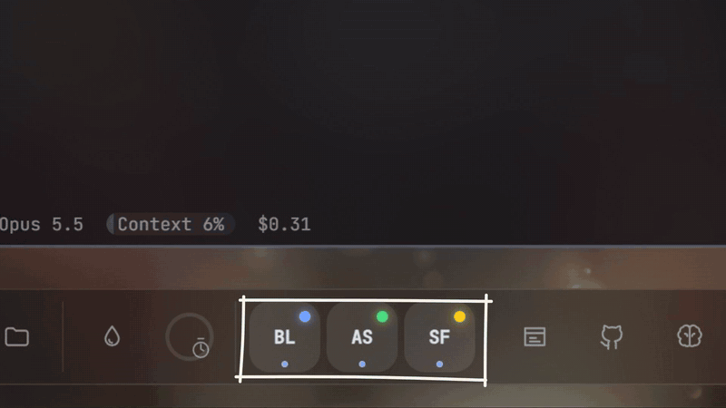

<div align="center">

<a href="https://fxd-gif.github.io/vibedesk/"></a>

<br/>

<a href="https://github.com/fxd-gif/vibedesk/releases/latest"></a>&nbsp;&nbsp;<a href="https://www.youtube.com/watch?v=SLLYiK34I88"></a>

<br/>

[](https://github.com/fxd-gif/vibedesk/releases/latest)
[](LICENSE)

[](https://m8ven.ai/mcp/fxd-gif-vibedesk-nx57jc?s=readme)

**English** · [Deutsch](README.de.md) · [Website](https://fxd-gif.github.io/vibedesk/)

</div>

<br/>

VibeDesk is a full-screen workspace for Windows built around [Claude Code](https://docs.claude.com/en/docs/claude-code). Instead of switching between terminals, a browser and a music app, you sit in front of a rainy window, and the things you need for building float in front of it as glass windows.

It runs the real Claude Code CLI in real terminals. VibeDesk adds the view around it: what each session is doing, what it is waiting for, and what it costs.

<p align="center"></p>

<br/>

<table>
<tr>
<td width="56%"></td>
<td>

### Every session at a glance

A dot per session: **green** while Claude works, **yellow** when it waits for you (and for how long), **blue** when it is done.

Permission requests show up as a card with *Allow*, *Always* and *Deny*, so you never dig through four terminals to find the one that is stuck.

</td>
</tr>
<tr>
<td>

### Walk away without losing time

Open VibeDesk on your phone, scan a QR code, and answer permission requests from the couch. Watch the terminal live, nudge Claude with a few keys, or type a rough idea that Claude turns into a clear prompt.

Hit your usage limit? VibeDesk waits for the reset and tells Claude to carry on.

</td>
<td width="44%" align="center"></td>
</tr>
<tr>
<td width="56%"></td>
<td>

### Parallel sessions, safe merges

Merge Studio gives every session its own Git worktree and branch. It predicts conflicts before anything is touched, shows the files side by side and sets a checkpoint before every merge.

Merge a whole branch, single files or single hunks. Restoring is one click.

</td>
</tr>
<tr>
<td>

### Claude remembers your project

The brain is a set of Markdown notes in your project, readable in Obsidian. Claude reads it at the start of every session and writes down decisions, pitfalls and conventions as it goes.

A personal brain remembers how *you* like to work, across all projects. Nothing leaves your PC.

</td>
<td width="44%"></td>
</tr>
<tr>
<td width="56%"></td>
<td>

### A calm place to sit

Rain runs down the window over a city at night, a forest, a Tokyo alley or your own photo. Lofi radio or your Spotify, a focus timer, and rain sound with its own volume.

The dock grows with your work. Tools appear only when they have something to do.

</td>
</tr>
<tr>
<td>

### Zen when you need it

<kbd>Ctrl</kbd> + <kbd>.</kbd> hides everything except Claude and the rain. Other sessions shrink to small pills at the top and still turn yellow when they need you.

One card at a time, "done" messages are bundled, and the dock dims while you type.

</td>
<td width="44%"></td>
</tr>
</table>

<br/>

## Coming in 2.0 &nbsp;<sub>Sunday, 1 November 2026</sub>

We ship one bigger, tested release at a time instead of many small ones. Countdown and plan are on the [website](https://fxd-gif.github.io/vibedesk/#next).

<table>
<tr>
<td width="50%" valign="top">

**🌨️ Living scenes**<br/>
Ask Claude for an interactive background: snow that settles on the roof in your own photo, fireflies that follow your mouse, a thunderstorm on click. Claude writes the scene, looks at it and refines it.

</td>
<td width="50%" valign="top">

**✅ Session wrap-up** · [#1](https://github.com/fxd-gif/vibedesk/issues/1)<br/>
When Claude finishes, get a short summary, the changed files, what went into the brain and a suggested commit. One click commits it.

</td>
</tr>
<tr>
<td valign="top">

**🔀 Pull requests from the Git window** · [#2](https://github.com/fxd-gif/vibedesk/issues/2)<br/>
Branch, push and open a PR without leaving VibeDesk. Claude writes the title and description, you check and send.

</td>
<td valign="top">

**🟡 Tray status** · [#3](https://github.com/fxd-gif/vibedesk/issues/3)<br/>
See which session waits for you while VibeDesk is minimized, and answer permission requests right from the tray.

</td>
</tr>
<tr>
<td valign="top">

**📊 Budget per project** · [#4](https://github.com/fxd-gif/vibedesk/issues/4)<br/>
Set a cost or token budget per day or week. A quiet heads-up at 75 %, a notification at 100 %. Claude is never stopped.

</td>
<td valign="top">

**🧭 Claude runs your desk**<br/>
Claude can see your other sessions and hand them tasks, check usage and limits, set a budget and leave you a reminder.

</td>
</tr>
</table>

<details>
<summary><b>Also in 2.0</b></summary>

- **Hand-off between sessions** · [#6](https://github.com/fxd-gif/vibedesk/issues/6): when one session hands a task to another, its summary and changed files go along
- **How long has it been waiting?** · [#5](https://github.com/fxd-gif/vibedesk/issues/5): "waiting · 3 min" on the session, in the tray and on your phone
- **Project templates:** start a new project as a website, React app, small game, Python tool, Discord bot and more – Claude sets up the skeleton
- **Your own music:** play a folder of music from your PC, next to lofi radio and Spotify
- **Hotspots in the brain:** files that change most glow warm; the ones without a note get a dotted ring
- **Windows per project:** tool windows return to where they were in each project
- **Git window:** "Let Claude solve it" for merge conflicts, and a quiet brain check before you commit
- **Dictate and snip:** talk to Claude through Windows voice typing, or send a screen snip as an image
- **Brain from your docs:** turn `CLAUDE.md`, `AGENTS.md` and the README into linked starter notes – instantly, without tokens
- **Addons:** new triggers (file changed, tool used, commit, preview error) and a flow debugger that lights up the running step
- **Share living scenes:** send a scene Claude built for you as a share code – your friends get a live preview first
- **Gemini CLI and Codex (beta):** start a session with another agent in the same calm desktop, with its own status dot
- **Diagnostics, performance meter and a scene that follows the time of day**

</details>

Missing something? [Wish for a feature](https://github.com/fxd-gif/vibedesk/issues/new?template=feature_request.yml). The wishes with the most 👍 move into the next release.

<br/>

## Everything VibeDesk does

<details>
<summary><b>Calm by default</b></summary>

- The dock grows with your work: tools appear only when they have something to do (Git after Claude changed files, Merge Studio with two sessions, …)
- **Toolbox:** start "Simple" and switch modules like addons, phone companion, Discord or streamer mode on when you want them
- **Zen mode** (<kbd>Ctrl</kbd> + <kbd>.</kbd>): only Claude and the rain, other sessions as small pills at the top
- One card at a time, "done" messages are bundled, and the dock dims while you type
- **Two layouts.** *Desktop:* free floating glass windows and a dock that grows with what you use. *Studio:* a sidebar on the left, every window as a full page, and a status bar with project, branch, uncommitted changes and what Claude is doing. Switch in Settings or via the command palette

</details>

<details>
<summary><b>Atmosphere</b></summary>

- Rain running down the window (WebGL): city at night, forest, a Tokyo alley, or your own picture
- Lofi radio or **Spotify** (control your Spotify app: playlists, liked songs, queue), plus synthetic rain sound with separate volume controls
- **Your own music** from a folder on your PC (mp3, m4a, aac, ogg, opus, wav, flac): subfolders as groups, shuffle, repeat, remembers the last track – no account, no internet, nothing leaves your PC
- Focus timer (Pomodoro); audio gets quieter during breaks
- Streamer mode: hides API keys, passwords, user names and e-mail addresses, locks `.env` files in the editor; a curtain (<kbd>Ctrl</kbd> + <kbd>Shift</kbd> + <kbd>H</kbd>) covers the whole screen

</details>

<details>
<summary><b>Claude Code sessions</b></summary>

- Several sessions in parallel, each with live status in the dock: working · waiting for you · done
- Permission cards with Allow · Always · Deny, or "In terminal" for the usual prompt
- Notifications as cards, Windows toasts while VibeDesk is in the background, and a history behind the bell. During focus rounds only important ones come through
- Prompt queue: line up follow-up prompts that start as soon as Claude is done
- Quick prompt from anywhere: <kbd>Ctrl</kbd> + <kbd>Alt</kbd> + <kbd>Space</kbd> opens an input field over any app
- Watchdog: tells you when a session hangs without activity, fails at the same command three times, or the context is 85 % full, with a suggested next step
- Terminal with copy/paste like Windows Terminal, clickable links and file paths, search, zoom, attachments and a PowerShell next to Claude
- Resume earlier sessions with one click
- Hit your usage limit? VibeDesk reads the reset time and tells Claude to carry on once the limit is free again
- Rewind button: jump Claude's conversation and code back to an earlier step
- **Plan card:** plans from plan mode show up as a readable card – "Let's go", or "Change …" to send Claude your feedback
- **Plan limit at a glance** (Pro/Max): how much of the 5-hour and weekly limit is used, with a quiet heads-up at 75 % and 90 %
- **Dev server in one click:** "▶ Dev server" starts your `dev` script (npm, pnpm, yarn or bun) in a shell next to Claude
- **Claude can drive VibeDesk (MCP):** "sort my windows", "zen mode on", "tokyo scene with more rain" – Claude does it
- **Beta: Gemini CLI and Codex:** start a session with the Gemini CLI or OpenAI's Codex CLI instead (Projects → ⋯ or the command palette) – terminal, dock dot and a simple status; Claude-only extras like permission cards, plan card, wrap-up, costs and the brain stay off

</details>

<details>
<summary><b>Merge Studio (beta): parallel sessions</b></summary>

- "Isolated session": Claude gets its own working folder (Git worktree) on its own branch, so parallel sessions never get in each other's way
- Session cards with branch, changed files, +/−, live status and a badge: ready · review · conflicts
- Conflict prediction with `git merge-tree` – against the target branch and between sessions, even for uncommitted changes – without touching anything
- Side-by-side file comparison: session · current target · other session
- Merge a whole branch, selected files or selected hunks (3-way apply). Uncommitted changes in the target are never overwritten; risky steps always ask first
- Automatic checkpoints before every merge (as Git refs under `refs/vibedesk/checkpoints`, not in your history) and one-click restore
- AI summary with risks and recommended next steps; run your tests inside the session folder before merging

</details>

<details>
<summary><b>Inspector and stats</b></summary>


- Live feed of every action, todo progress, a tree of subagents, and stats in one tabbed window
- Context usage, tokens, cache hit rate and estimated cost, per session and per day
- Vibe Wrapped: a weekly summary card (active time, prompts, changed files, top projects) you can copy as an image

</details>

<details>
<summary><b>The brain (project memory)</b></summary>

- Notes in `.vibedesk/brain` inside your project: plain Markdown with `[[links]]`, readable in Obsidian and versionable with Git
- **About you:** a personal brain that applies to all projects. Claude remembers how you work and what you like – the longer you use VibeDesk, the better Claude fits you. Stays on your PC only
- Each session starts with an overview of this knowledge and can search, read and extend it through its own tools
- A live graph of notes and files; nodes light up while Claude reads, edits or learns something

</details>

<details>
<summary><b>Tools</b></summary>

- Code editor for quick fixes: clicking a file in the live feed opens it at the line Claude changed
- Preview window: local dev servers are detected and opened automatically. "Point at it" lets you click an element and tell Claude what to change (selector, text, HTML and a screenshot are sent along). Console errors can be sent to Claude with one click
- Git window: diff, stage, commit (Claude can write the message), branches, history, push/pull and publishing to GitHub, including GitHub login and installing Git/GitHub CLI
- Command palette (<kbd>Ctrl</kbd> + <kbd>K</kbd>) for all windows, projects and actions
- Prompt library and notes per project; install skills by drag & drop or GitHub link

</details>

<details>
<summary><b>Phone companion</b></summary>

- Open VibeDesk in your phone's browser: scan the QR code, pair with a 6-digit code from the PC screen
- See sessions, Claude's latest output, plan progress and notifications; answer permission requests (the phone vibrates)
- See what is happening: your last prompt and Claude's recent steps – and, if you allow it, the **whole terminal live** with colors and full history, plus a few keys (Esc, ↑, ↓, 1–3, Enter) for Claude's choice menus
- Type a rough idea and Claude turns it into a clear prompt; when Claude is done, the phone suggests three next steps
- Works in your Wi-Fi and, through a Cloudflare quick tunnel, from anywhere (can be switched off)

</details>

<details>
<summary><b>Addons</b></summary>

- Flowchart editor to build your own extensions without code, e.g. "when a session waits for me, switch to Tokyo and play a gong"
- Triggers, actions, conditions, loops, questions with buttons, signals, parallel branches, lists and calculations
- Macros that drive Claude: send prompts, wait until Claude is done, continue (rate-limited, with a clear warning on install)
- 10 templates to start from; share addons as `.vibeaddon` files and install them by double-click
- Addons only see their own building blocks: no file access, no shell commands, no internet. Before installing, VibeDesk shows in plain words what an addon does

</details>

<details>
<summary><b>Social and streaming</b></summary>

- Vibe Lounge: co-work with friends in a shared room, peer-to-peer without a VibeDesk server. See who is building, start focus rounds together, chat and react
- Share codes for prompts, skills and your atmosphere, always with a preview before applying
- Discord Rich Presence with your own texts, images and status icons, live status of what Claude is doing ("writing code", "running commands", current task with progress) and rotating lines; Discord webhook messages when a session waits for you and a daily summary
- OBS overlay (status, plan, live feed, focus timer) as a local browser source; Twitch chat suggestions via `!vibe …` that you approve

</details>

<br/>

## Install

1. Open the [latest release](https://github.com/fxd-gif/vibedesk/releases/latest) and download **`VibeDesk-Setup-<version>.exe`**.
2. Run it. A short welcome tour sets everything up.
3. From then on you can start VibeDesk with <kbd>Win</kbd> + <kbd>R</kbd> → `vibe`.

Updates are downloaded in the background from GitHub Releases and installed on the next start (or right away if no session is running).

**You need** Windows 10 or 11 (64-bit) and [Claude Code](https://docs.claude.com/en/docs/claude-code) with a Claude Pro/Max subscription or an Anthropic API key. Node.js (used for the hook forwarder) and Claude Code itself are offered for installation on first start if they are missing (Node.js via `winget`, Claude Code via the official installer script from claude.ai).

Costs shown in VibeDesk are **estimates** based on Anthropic's API prices. With a subscription you do not pay per token; the number is meant as orientation.

<details>
<summary><b>Windows says "Windows protected your PC"</b></summary>

<br/>

The installer is not code-signed, so Windows may show **"Windows protected your PC"**. Click **More info → Run anyway**.

This is common for small open-source projects: code-signing certificates cost money every year, and SmartScreen also warns about new apps that have not been downloaded often yet. It does not mean the file was flagged as malware.

If you want to make sure the file is the one published here, compare its SHA256 checksum with the one in the release notes:

```powershell
Get-FileHash .\VibeDesk-Setup-<version>.exe -Algorithm SHA256
```

The `Hash` value must match the checksum listed in the release notes exactly. You can also build VibeDesk yourself from source (see below).

</details>

<br/>

## Keyboard shortcuts

| Keys | What it does |
|---|---|
| <kbd>Win</kbd> + <kbd>R</kbd> → `vibe` | Start VibeDesk |
| <kbd>Ctrl</kbd> + <kbd>Alt</kbd> + <kbd>Space</kbd> | Quick prompt from any app |
| <kbd>Ctrl</kbd> + <kbd>K</kbd> · <kbd>Ctrl</kbd> + <kbd>Shift</kbd> + <kbd>P</kbd> | Command palette (inside the terminal only the second one) |
| <kbd>Ctrl</kbd> + <kbd>.</kbd> | Zen mode: only the current session |
| Hold <kbd>Esc</kbd> · <kbd>F11</kbd> | Leave full screen |
| <kbd>Ctrl</kbd> + <kbd>Shift</kbd> + <kbd>H</kbd> | Curtain (hide the screen) |
| <kbd>Ctrl</kbd> + <kbd>S</kbd> | Save in the editor |
| Drag a window to the edge | Half screen width |

<br/>

## Privacy

VibeDesk has **no telemetry, no analytics and no account**. There is no VibeDesk server.

<details>
<summary><b>What stays local</b></summary>

- Claude Code hook events go to a local server on `127.0.0.1` (random port, random token).
- VibeDesk reads Claude Code's transcripts in `~/.claude/projects` (or `CLAUDE_CONFIG_DIR`) to show feed, todos and stats.
- The error log stays on your PC: `%APPDATA%\vibedesk\logs\fehler.log`. "Report a bug" only opens a pre-filled GitHub issue in your browser (version, Windows version, Claude Code version and the end of the error log, with user names in paths masked). You see everything before you submit, and nothing is sent unless you do.

</details>

<details>
<summary><b>What connects to the internet, and when</b></summary>

<br/>

| What | Where to | When |
|---|---|---|
| Lofi radio | the selected stream (laut.fm by default; also ilovemusic.de, zeno.fm) | while music is on (on by default) |
| Update check and download | GitHub Releases | on start |
| Claude Code itself, AI commit messages, Merge Studio review, prompt formulation on the phone | Anthropic, through your own Claude Code | when you use Claude |
| Spotify | accounts.spotify.com (login) and api.spotify.com (control playback), with your own Spotify app ID | only if you connect Spotify |
| Skill downloads | GitHub (codeload.github.com) | when you install a skill from a link |
| Git window | your Git remotes; GitHub login via the GitHub CLI (device code in the browser) | when you push, pull, log in or publish |
| Installing tools | winget / claude.ai installer | only when you click install |
| Discord Rich Presence | your local Discord app; discord.com for app info if you use your own app ID | only if enabled |
| Discord webhook | your Discord webhook URL | only if enabled |
| Twitch chat suggestions | Twitch chat (anonymous, read-only) | only if enabled |
| Phone companion | local network on port 17350; with "from anywhere" on (default once the companion is enabled) a Cloudflare quick tunnel (`*.trycloudflare.com`, cloudflared is installed via winget) | only while the companion is switched on |
| Vibe Lounge | public Nostr relays for signaling (encrypted with the room code), then WebRTC directly between participants, who can see each other's IP address | only while you are in a lounge |

</details>

<details>
<summary><b>What VibeDesk changes on your PC</b></summary>

- **In your projects:** with the brain turned on (default), VibeDesk creates a `.vibedesk/` folder with the brain notes. Add it to `.gitignore` if you do not want to commit it.
- **Merge Studio:** isolated sessions are Git worktrees in `.vibedesk/worktrees/` on branches named `vd/…`. VibeDesk adds that folder to the repository's local `.git/info/exclude` (your `.gitignore` stays untouched). Checkpoints are Git refs under `refs/vibedesk/checkpoints/`; delete them with `git for-each-ref --format="%(refname)" refs/vibedesk | % { git update-ref -d $_ }`.
- **Claude Code settings:** VibeDesk does **not** edit your `~/.claude/settings.json` or project settings. For sessions started in VibeDesk it writes a temporary settings file with its hooks (and, with the brain on, an MCP config for the brain tools) to `%TEMP%\vibedesk` and passes it via `--settings` / `--mcp-config`. Sessions you start outside VibeDesk are not affected.
- **Skills** you install go to `~/.claude/skills` (or the project's `.claude/skills`).
- **Run alias:** `vibe` for <kbd>Win</kbd> + <kbd>R</kbd> is a registry entry under `HKCU\Software\Microsoft\Windows\CurrentVersion\App Paths\vibe.exe`.

</details>

<details>
<summary><b>Uninstall</b></summary>

<br/>

Uninstall VibeDesk from **Settings → Apps**. The uninstaller removes the program, but these stay on your PC:

| What | Where |
|---|---|
| Settings, projects list, stats, addons, scenes, notes, error log | `%APPDATA%\vibedesk` |
| Temporary files (session settings, pasted screenshots) | `%TEMP%\vibedesk` |
| Brain notes | `.vibedesk\` in each project you opened |
| Run alias | `HKCU\Software\Microsoft\Windows\CurrentVersion\App Paths\vibe.exe` |
| Tools you let VibeDesk install | Node.js, Claude Code, Git, GitHub CLI, cloudflared (each uninstallable on its own) |

To remove everything, run in PowerShell after uninstalling:

```powershell
Remove-Item -Recurse -Force "$env:APPDATA\vibedesk", "$env:TEMP\vibedesk" -ErrorAction SilentlyContinue
Remove-Item "HKCU:\Software\Microsoft\Windows\CurrentVersion\App Paths\vibe.exe" -Recurse -ErrorAction SilentlyContinue
```

Delete the `.vibedesk` folders in your projects by hand if you do not want to keep the notes.

</details>

<br/>

## FAQ

<details>
<summary><b>Is this an official Anthropic product?</b></summary>

No. VibeDesk is an independent open-source project. It uses the Claude Code CLI that you install and log in to yourself.

</details>

<details>
<summary><b>Does it work on macOS or Linux?</b></summary>

Not yet. VibeDesk is Windows-only for now.

</details>

<details>
<summary><b>What does it cost?</b></summary>

VibeDesk is free and open source (MIT). You only need your own Claude subscription or API key for Claude Code.

</details>

<details>
<summary><b>Is the interface available in English?</b></summary>

Yes. VibeDesk follows your Windows language (German or English). Switch it in the More menu under "Sprache · Language".

</details>

<br/>

## Build from source

Requires Node.js and npm.

```bash
npm install
npm run dev      # development with hot reload
npm run dist     # build the installer into dist/
```

## Feedback and support

Questions, bug reports and ideas all go to [GitHub Issues](https://github.com/fxd-gif/vibedesk/issues). Inside the app, "Report a bug" opens a pre-filled issue for you. Security issues: please see [SECURITY.md](SECURITY.md).

## License

[MIT](LICENSE) © 2026 fxd-gif

<br/>

<div align="center">

<br/>
<sub>Built with Electron, React and WebGL.<br/>Not affiliated with Anthropic. Claude is a trademark of Anthropic.</sub>
</div>
